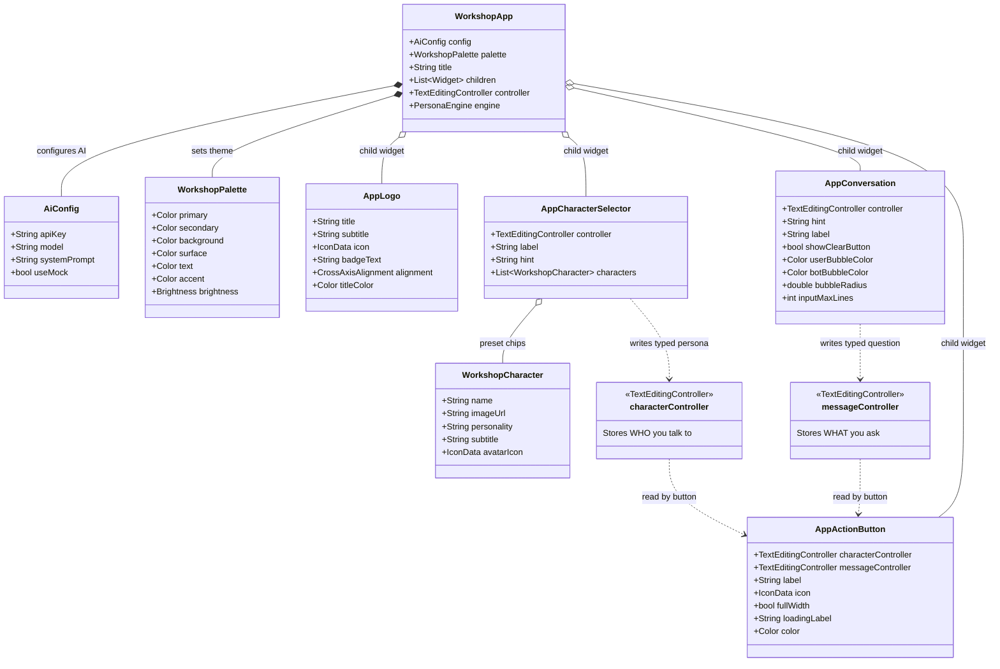

# Workshop Widgets & Configs Reference

This reference documents all configuration classes, data models, and UI widgets available in the workshop codebase.

---

## Architecture Diagram (Mermaid)

---

## Detailed Field Reference

### 1. Config Classes

#### `AiConfig`
| Field | Type | Default | Required? | Description |
|---|---|---|---|---|
| `apiKey` | `String` | `''` | Optional (Required for live API) | API key from Google AI Studio. |
| `model` | `String` | `'gemini-3.5-flash-lite'` | Optional | Exact model name passed to the Gemini API. |
| `systemPrompt` | `String` | `''` | Optional | Custom global system instructions passed to the LLM (supports `{character}` and `{personality}` tokens). Overrides default roleplay prompt when set. |
| `useMock` | `bool` | `true` | Optional | When `true`, returns mock responses locally without network calls. Set to `false` for real AI. |

#### `WorkshopPalette`
| Field | Type | Default | Required? | Description |
|---|---|---|---|---|
| `primary` | `Color` | `Color(0xFF8ABFFF)` | Optional | Brand accent used on buttons, icons, and chip selections. |
| `secondary` | `Color` | `Color(0xFF22364B)` | Optional | Secondary tone for title accents and chip backgrounds. |
| `background` | `Color` | `Color(0xFF101215)` | Optional | Scaffold background color. |
| `surface` | `Color` | `Color(0xFF282C34)` | Optional | Surface color for cards, input containers, and chips. |
| `text` | `Color` | `Color(0xFFF5F7FA)` | Optional | High-contrast body typography color. |
| `accent` | `Color` | `Color(0xFF8ABFFF)` | Optional | Accent highlight color. |
| `brightness` | `Brightness` | `Brightness.dark` | Optional | Brightness mode (`Brightness.dark` or `Brightness.light`). |

#### `WorkshopCharacter`
| Field | Type | Default | Required? | Description |
|---|---|---|---|---|
| `name` | `String` | *(Positional)* | **Required** | Character display name (e.g. `'Socrates'`, `'Sherlock Holmes'`). |
| `imageUrl` | `String` | `''` | Optional | Web image URL for avatar in response card. |
| `personality` | `String` | `''` | Optional | System prompt instructions shaping response tone and style. |
| `subtitle` | `String` | `''` | Optional | Short description or role (e.g. `'Ancient Greek Philosopher'`). |
| `avatarIcon` | `IconData?` | `null` | Optional | Fallback Material icon if no image URL is provided. |

---

### 2. UI Widgets

#### `WorkshopApp`
The root wrapper that provides theming, the inherited state scope (`PersonaEngine`), and a centered, responsive single-column layout.

| Field | Type | Default | Required? | Description |
|---|---|---|---|---|
| `config` | `AiConfig` | `const AiConfig()` | Optional | AI provider, API key, model, and mock mode configuration. |
| `palette` | `WorkshopPalette` | `const WorkshopPalette()` | Optional | Colors and brightness theme settings. |
| `title` | `String` | `'character.AI'` | Optional | App title string. |
| `children` | `List<Widget>` | `const []` | Optional | Vertical list of widgets spaced automatically (20px gap). |
| `controller` | `TextEditingController?` | `null` | Optional | Root controller shared via `WorkshopScope`. |
| `engine` | `PersonaEngine?` | `null` | Optional | Custom state engine instance if overriding default. |

#### `AppLogo`
Header branding component with split two-tone title formatting.

| Field | Type | Default | Required? | Description |
|---|---|---|---|---|
| `title` | `String` | `'character.AI'` | Optional | App title. The first dot splits colors using `primary` / `secondary`. |
| `subtitle` | `String` | `''` | Optional | Subtitle tagline rendered beneath title. |
| `icon` | `IconData?` | `null` | Optional | Circled icon rendered above title. |
| `badgeText` | `String` | `''` | Optional | Small uppercase badge pill next to title (e.g. `'PRO'`, `'V2'`). |
| `alignment` | `CrossAxisAlignment` | `CrossAxisAlignment.center` | Optional | Horizontal alignment (`center`, `start`, `end`). |
| `titleColor` | `Color?` | `null` | Optional | Direct color override for title text. |

#### `AppCharacterSelector` *(Alias: `AppCharacterInput`)*
Text input for typing any character name, with optional quick-select chips underneath.

| Field | Type | Default | Required? | Description |
|---|---|---|---|---|
| `controller` | `TextEditingController?` | `null` | Optional | Controller to bind and read character text. |
| `label` | `String` | `'CHARACTER / PERSONA'` | Optional | Upper label string (hide by passing `''`). |
| `hint` | `String` | `'Type any character...'` | Optional | Placeholder string shown when field is empty. |
| `characters` | `List<WorkshopCharacter>` | `const []` | Optional | Preset chips below input for 1-tap character selection. |

#### `AppConversation`
Combines user query input box, user avatar, and reactive AI response card with character avatar and error display.

| Field | Type | Default | Required? | Description |
|---|---|---|---|---|
| `controller` | `TextEditingController?` | `null` | Optional | Controller for user message input. |
| `hint` | `String` | `'Ask anything...'` | Optional | Placeholder text inside message input. |
| `label` | `String` | `'YOUR MESSAGE'` | Optional | Upper label string (hide by passing `''`). |
| `showClearButton` | `bool` | `true` | Optional | Whether to display the 'X' button to clear input. |
| `userBubbleColor` | `Color?` | `null` | Optional | Background fill color for user message card. |
| `botBubbleColor` | `Color?` | `null` | Optional | Background fill color for bot response card. |
| `bubbleRadius` | `double` | `16.0` | Optional | Border radius for cards and input containers. |
| `inputMaxLines` | `int` | `3` | Optional | Maximum lines the user input field expands to. |

#### `AppActionButton`
Trigger button that reads both character & message controllers, executes AI generation, displays loading state, and switches to "Chat again" on completion.

| Field | Type | Default | Required? | Description |
|---|---|---|---|---|
| `characterController` | `TextEditingController?` | `null` | Optional | Character input controller. Reads text before generation. |
| `messageController` | `TextEditingController?` | `null` | Optional | Message input controller. Reads question before generation. |
| `controller` | `TextEditingController?` | `null` | Optional | Backward-compatible alias for `messageController`. |
| `label` | `String` | `'Send message'` | Optional | Label shown in idle state. |
| `icon` | `IconData` | `Icons.arrow_upward_rounded` | Optional | Icon displayed beside label. |
| `fullWidth` | `bool` | `false` | Optional | Stretches button across entire container width when `true`. |
| `loadingLabel` | `String` | `'Thinking...'` | Optional | Label shown while waiting for response. |
| `color` | `Color?` | `null` | Optional | Background color override for the button. |
